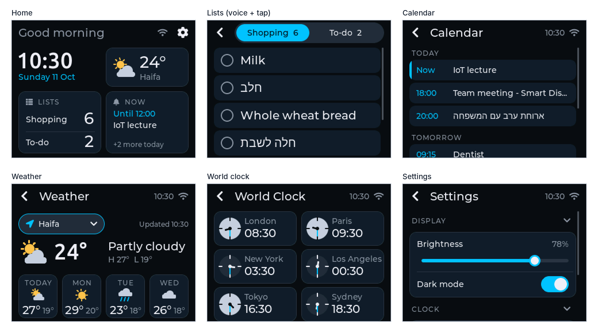
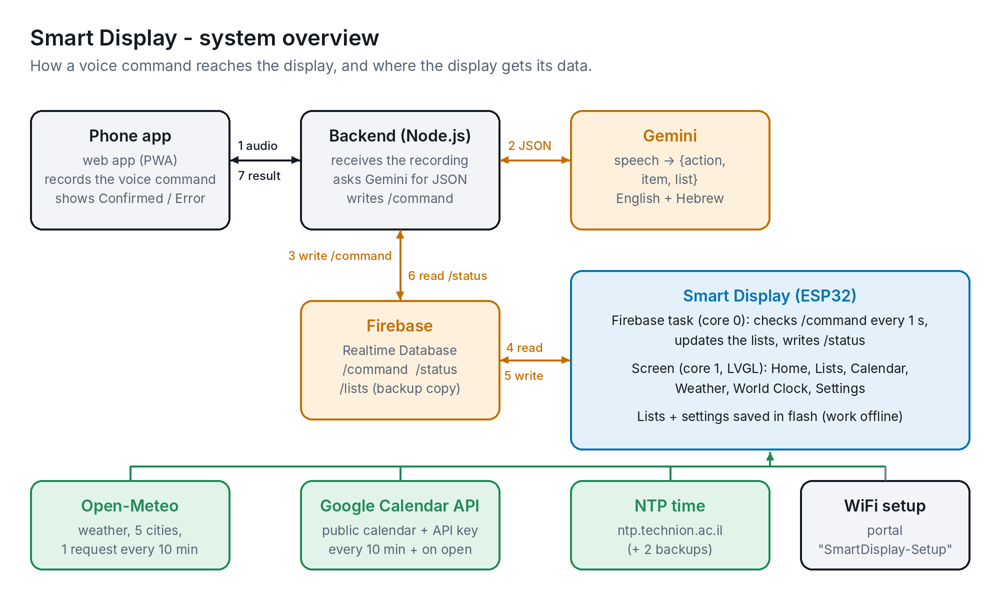
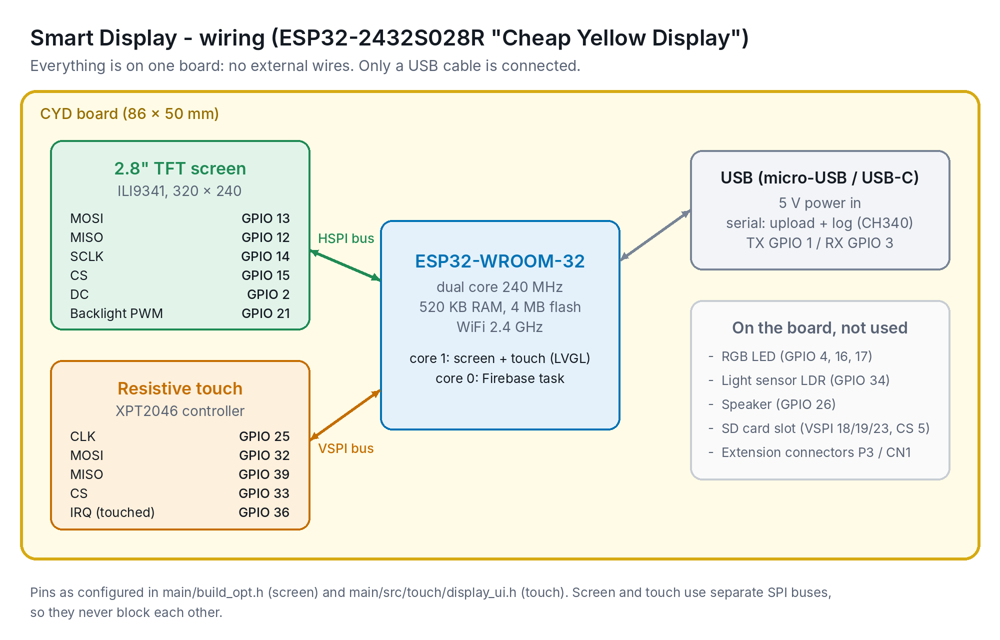

# Smart Display - ESP32 firmware (`dispaly`)

A smart display for the desk or the kitchen: time and date, a world clock, weather and a
4-day forecast for 5 Israeli cities, your Google Calendar, and shopping / to-do lists that
you update **by voice** from a phone app (through Gemini and Firebase). Touch interface with
dark and light themes, English and Hebrew text, power saving, and it keeps working offline.
This repository is the ESP32 firmware; the phone app is in its own repository (below).

<!-- Poster: add a photo of the project poster as assets/poster.jpg and remove the comment marks:

-->



## Team

IoT project course 236333, Technion Faculty of Computer Science, group 5א:
**Shada Nujeidat, Yuval Carmelli, Liat Rokach**.

## Project repositories

| Repository | Contents |
|---|---|
| **dispaly** (this one) | ESP32 firmware, unit tests, documentation, diagrams |
| **Smart Display app** ([github.com/IOT-Project-SUM2026/app](https://github.com/IOT-Project-SUM2026/app)) | phone web app (PWA) + Node.js backend that sends the voice recording to Gemini and writes the command to Firebase. Libraries and versions: its `package.json` |

The final version of each repository is on its `main` (master) branch.

## How it works



1. The phone app records a command ("add milk to the shopping list") and sends it to the backend.
2. The backend asks Gemini to turn it into JSON `{action, item, list}`, checks it, and adds it to a queue in Firebase `/commands`.
3. The display checks `/commands` every 2 seconds (in its own task on the second CPU core), updates the list, saves it in flash, shows it with a pop-up, and writes the result to `/status`.
4. The app shows the result. If the display is offline, the backend answers right away from the copy of the lists in `/lists`, and the display applies the command when it is back. Weather (Open-Meteo), calendar (Google Calendar API) and time (NTP) are downloaded by the display directly.

## Hardware

| Part | Quantity | Notes |
|---|---|---|
| ESP32-2432S028R "Cheap Yellow Display" (ESP32 + 2.8" 320×240 ILI9341 screen + XPT2046 resistive touch) | 1 | everything is on this one board |
| Micro-USB data cable | 1 | some cables are charge-only and won't upload |
| USB power adapter, 5 V ≥ 1 A | 1 | a laptop port may be too weak with WiFi and the backlight on |
| Enclosure: front bezel, back shell, stand leg (3D printed, PLA) | 1 set | [assets/enclosure_sketch.png](assets/enclosure_sketch.png) |
| M3 screws (6 mm ×4 for the board, 10 mm ×4 for the case) | 8 | for the enclosure |
| Smartphone with a browser | - | the user's own, runs the voice app |

### Wiring diagram

All parts are on the board, so there is no external wiring: only the USB cable.
Pins: [Documentation/pinout_wiring.md](Documentation/pinout_wiring.md).



## Versions

| | Version |
|---|---|
| Arduino IDE | 2.x |
| Board package: esp32 by Espressif Systems | 3.3.12 (board: ESP32 Dev Module, partition: Huge APP) |
| TFT_eSPI (Bodmer) | 2.5.43 |
| lvgl (kisvegabor) | 9.6.0 |
| XPT2046_Touchscreen (Paul Stoffregen) | 1.4.0 |
| WiFiManager (tzapu) | 2.0.17 |
| ArduinoJson (Benoit Blanchon) | 7.4.3 |

The same versions are pinned in `main/sketch.yaml`, so `upload.bat` / `arduino-cli` install exactly these.

## What's in this repository

```
dispaly/
├── README.md                 this file
├── upload.bat                one-click build + upload (Windows)
├── main/                     Arduino sketch (open main/main.ino)
│   ├── secrets.example.h     optional starting values (Firebase login, calendar key; secrets.h is not in git)
│   ├── main.ino, *.h         setup/loop, globals, shared LVGL widgets
│   ├── build_opt.h           screen + LVGL configuration
│   ├── sketch.yaml           pinned versions for Arduino CLI
│   └── src/                  one folder per feature
│       ├── home/             home screen (greeting, clock, weather, Lists and Next event cards)
│       ├── time_date/        NTP time, home clock, world clock screen
│       ├── idle/             power saving (dim / screen off after inactivity)
│       ├── storage/          settings saved in flash (Preferences)
│       ├── theme/            design system: colors, shared styles, clock and Hebrew fonts
│       ├── touch/            LVGL + display + touch init, screen switching, voice command pop-up
│       ├── weather/          weather fetch (all cities at once), city choice, weather screen
│       ├── settings/         settings screen (folding sections: display, clock, power saving)
│       ├── wifi/             WiFi setup portal, connection status
│       ├── lists/            shopping + to-do lists (saved in flash), lists screen
│       ├── calendar/         Google Calendar events, calendar screen
│       ├── firebase/         voice commands from the app via Firebase
│       ├── config/           Firebase login + calendar settings (setup page, saved in flash)
│       ├── net/              secure connections, "is the internet up?", background downloads
│       └── health/           watchdog, restart reason, health log
├── unit_tests/               one sketch per hardware part / service, see unit_tests/README.md
├── tools/test_lists/         list sync test that runs on a computer (see its README)
├── tools/test_home_layout/   Home widget layout test (all 80 combinations), runs on a computer
├── Documentation/            guides (list below)
└── assets/                   diagrams, enclosure sketch, screenshots (assets/screenshots/)
```

| Document | Contents |
|---|---|
| [Documentation/user_guide.md](Documentation/user_guide.md) | how to use the display and the app, what each indicator means |
| [Documentation/install_instructions.txt](Documentation/install_instructions.txt) | step-by-step setup for developers |
| [Documentation/parameters.md](Documentation/parameters.md) | every hard-coded parameter, saved settings, touch calibration |
| [Documentation/errors_and_states.md](Documentation/errors_and_states.md) | what the display shows in each state, log messages, errors and fixes |
| [Documentation/pinout_wiring.md](Documentation/pinout_wiring.md) | CYD pins and further reading |
| [Documentation/ui_design.md](Documentation/ui_design.md) | the design system (colors, fonts, spacing) and screen layouts |
| [unit_tests/README.md](unit_tests/README.md) | the 9 hardware / service tests and how to run them |
| [Documentation/course_submissions/](Documentation/course_submissions/) | course documents: user stories, HW unit tests report (with results), feasibility tests, edge cases design, enclosure sketch |

## Quick start (Windows): `upload.bat`

1. Install **Arduino IDE 2** from arduino.cc (the script uses the `arduino-cli` inside it).
2. Plug in the board (install the **CH340** USB driver if no COM port shows up).
3. Double-click **`upload.bat`**, type the board's COM port when asked.

The script downloads the exact ESP32 board package and library versions from
`main/sketch.yaml` on first run, builds with the right partition scheme, uploads, and
can open the serial monitor. Nothing to install or configure by hand. Close Arduino IDE's
Serial Monitor first, since it holds the COM port. Run `upload.bat clean` for a full
rebuild after changing `build_opt.h`.

Prefer Arduino IDE? Follow the two sections below instead.

## One-time setup (per computer)

1. Install **Arduino IDE 2** from arduino.cc.
2. **Board package:** Tools → Board → Boards Manager → search `esp32` → install
   **esp32 by Espressif Systems**, version **3.3.12**.
3. **Libraries:** Tools → Manage Libraries, install these exact versions:

   | Library | Author | Version |
   |---|---|---|
   | TFT_eSPI | Bodmer | 2.5.43 |
   | lvgl | kisvegabor | 9.6.0 |
   | XPT2046_Touchscreen | Paul Stoffregen | 1.4.0 |
   | WiFiManager | tzapu | 2.0.17 |
   | ArduinoJson | Benoit Blanchon | 7.4.3 |

4. **USB driver:** plug in the board. If no new COM port appears under Tools → Port,
   install the **CH340** driver (the CYD's USB chip) and replug.

## Build and upload

1. Open **`main/main.ino`** (always open it from `main/`, see Troubleshooting).
2. Tools → Board → esp32 → **ESP32 Dev Module**.
3. Tools → Partition Scheme → **Huge APP (3MB No OTA/1MB SPIFFS)**. The firmware doesn't fit the default 1.3 MB app partition with LVGL.
4. Tools → Port → the board's COM port.
5. Click **Upload**. If it hangs on `Connecting...`, hold the **BOOT** button on the
   board until the upload starts.

The first build takes several minutes because the whole ESP32 core and LVGL are compiled.
Later builds only recompile your changes and are much faster.

## First boot: WiFi

The display starts right away and works offline. Until WiFi is set up it shows the offline WiFi icon and runs a setup portal in the background:

1. On your phone, join the WiFi network **`SmartDisplay-Setup`**, password **`smartdisplay`** (shown on the display in Settings → Device while it has no WiFi; change it with `SETUP_AP_PASSWORD` in `wifi_setup.h`).
2. A setup page opens (otherwise browse to `192.168.4.1`) → *Configure WiFi* →
   pick your network and enter the password.
3. The board connects (the WiFi icon updates within ~2 s) and the weather appears. It remembers
   the network, so later boots skip this step.

## Setup page: Firebase login and Google Calendar (no code)

The Firebase login (voice commands) and the Google Calendar ID and key are set from a phone,
on the **Setup** page of the setup portal. They are saved in the board's flash, so a new user
never edits code. Saving restarts the display with the new values.

- First boot: join `SmartDisplay-Setup` (see above) → **Setup**.
- Later, on the home WiFi: on the display, Settings → Device → **Setup page**. It shows an
  address like `http://192.168.1.23`; open it on a phone on the same WiFi → **Setup**. The page
  closes by itself after 10 minutes.
- Passwords and keys are never shown on the page: leave a field empty to keep the saved value.
- The firmware-upload page of the portal is turned off (the portal network has no password).

Values (Firebase console, project `smart-display-5f14b`):
- Database URL: Realtime Database → Data (link at the top)
- Web API key: Project settings → General → Your apps → `apiKey`
- Display user email / password: the display's user from Authentication → Users
- Calendar ID and API key: see Google Calendar below

For development you can also put starting values in `main/secrets.h` (copy `secrets.example.h`).
They are used until something is saved on the Setup page. It is in `.gitignore`: **never upload it
to GitHub** (also not by drag-and-drop on the website). Without it the firmware still builds: voice
commands and the calendar show "Not set up" until the Setup page is filled in.

After setup the Serial Monitor shows `[Firebase] Signed in`, then `[Firebase] Listening for commands`,
and Settings → Device shows Voice commands: **Working**.

Firebase setup this relies on (done once, in the console):
- Authentication → Sign-in method → **Email/Password** enabled, and a user for the display.
- Realtime Database → Rules: `{ "rules": { ".read": "auth != null", ".write": "auth != null" } }`.
  The phone app's backend uses the Admin SDK, which ignores these rules.

### How voice commands reach the display

The app's backend adds every command to a queue:
`/commands/<id>` = `{ "type": "add" | "remove", "item": "milk", "list": "shopping" | "todo", "createdAt": <ms> }`.
`<id>` is a Firebase push id (ids sort in the order the commands were sent) and `createdAt` is
Firebase server time. The display reads the queue every 2 seconds, applies the commands oldest
first, and for each one, in a single request, writes
`/status/<id>` = `{ "success": true, "text": "Added milk to your shopping list" }` and removes
`/commands/<id>`.

- Removing an item that isn't on the list, or adding to a full list (20 items), sends `success: false`.
- Adding an item that is already there sends `success: true` ("milk is already on your shopping list").
- Every 10 s the display writes `/device/lastSeen` (server time). The backend treats the display
  as offline when it is older than 25 s.
- Firebase runs in its own FreeRTOS task on core 0, so checking the database never freezes the
  touchscreen (`loop()` runs on core 1).
- The display holds the lists (saved in flash, so they work offline) and keeps a copy in
  Firebase `/lists`. Screens read them with `listSize()` / `listItem()` from `src/lists/lists.h`;
  every access goes through a lock, because the Firebase task changes them too.

### Offline changes

The user never has to know whether the display is online. The app always gets an answer
within about 10 s:

- **Display online:** the backend waits for `/status/<id>` (normally 1-2 s) and shows the display's reply.
- **Display offline** (or no reply within 10 s): the backend answers from `/lists` plus the commands
  still waiting in the queue, and marks the command `answered: true`. The display applies it when
  it is back and doesn't write a `/status`.

The same item can also be changed on the screen while the display is offline, so commands can
arrive after a later tap. Every item therefore remembers **when** it was last added or removed
(`changedAt`, saved in flash), and the rule is: **the later change wins**. A command older than
the item's last change is ignored (`… was changed on the display after this request`). A removed
item is kept hidden for a while so it still remembers when it was removed (`LIST_SLOTS`).
Before the clock has synced, a tap is timed from boot and corrected when NTP syncs.

We checked every sequence of up to 6 changes (voice add, voice remove while the display is offline,
tap on the screen) for an item that starts on or off the list: without the times, one pattern
went wrong (item on the list, voice "add", then a tap removes it offline: the queued "add"
brought it back); with the times, none did. The test runs the real `lists.h` on a computer:
`tools/test_lists/` (see its README).

### Test without the phone app

In the Firebase console, open Realtime Database → Data, and under `commands` add a child with any
key (e.g. `test1`) containing `type`, `item` and `list` (without `createdAt` the display uses its
own clock). Within about a second the Serial Monitor shows the command and the
updated list, the child disappears and `/status/test1` appears.

Logs: Tools → Serial Monitor at **115200** baud. See [errors_and_states.md](Documentation/errors_and_states.md) for the log messages.

## Home screen widgets

Home has a greeting row (always) and four widgets: **Clock, Weather, Lists, Next event**.
In Settings → Home screen the greeting and each widget can be hidden, and one widget can be the
**Big widget**. With the greeting off, the top-left widget (when it is half width) grows up into the
free space beside the WiFi icon and gear, and a connection problem ("No internet") is shown next to the
WiFi icon instead:

- A hidden widget leaves no gap: the others grow into its space (e.g. without Weather the clock
  gets the whole top row).
- The big widget gets a whole row and most of the height; the others shrink to a compact version.
- Every widget draws itself for the size it gets: compact (under 64 px tall: one or two lines),
  normal (the original cards), and large (big clock digits; weather with condition and the
  forecast; Shopping and To-do side by side with their items; a list of upcoming events).
- Hiding Weather or Next event also turns that feature off (nothing is downloaded).

`home_layout.h` decides the places (tested for all 16 x 5 combinations: inside the screen, no
overlaps, at least 48 px tall, default = the original layout); each widget's `createHome...()`
function picks its version from its width and height.

## Voice commands on the screen

When a command arrives the display wakes up, opens the list it changed (a new item is
shown in the accent color) and shows the result at the top for 3 s, e.g. "Added milk to your
shopping list" (no transcription, per the instructor). If nobody touches it, it goes back
home after 30 s. If someone is using another screen (touched in the last 10 s, e.g. changing a
setting), only the pop-up appears and their screen stays open. The Firebase task never draws: it hands each command to `loop()` through a
FreeRTOS queue, because LVGL may only be used from one task.

The display also keeps a copy of both lists in Firebase at `/lists`. A change made without
WiFi is saved on the board and copied as soon as the connection is back.

## Google Calendar (optional)

The display reads a **public** Google calendar with an **API key**. Without it the calendar
shows "Not set up" and everything else works.

1. Google Calendar (computer) → Other calendars → + → Create new calendar.
2. Its Settings and sharing → Access permissions → **Make available to public** (See all event details).
3. Integrate calendar → copy the **Calendar ID**.
4. console.cloud.google.com → project `smart-display-5f14b` → APIs & Services → Library → **Google Calendar API** → Enable.
5. APIs & Services → Credentials → Create credentials → **API key**. Edit the key → API restrictions → **Restrict key** → Google Calendar API, so the key can't be used for anything else.
6. Enter both on the Setup page (above), or as starting values in `main/secrets.h`: `CALENDAR_ID`, `CALENDAR_API_KEY`.

## Project files

| File | Purpose |
|---|---|
| `main/main.ino` | `setup()` / `loop()` |
| `main/globals.h` | screen size, layout grid (margins, header and row heights), `Theme` struct |
| `main/shared_ui.h` | shared LVGL widgets: screen, label, card, header bar (back, title, time, WiFi), icon buttons, dropdown, messages, weather icons; Hebrew-aware text helpers |
| `main/src/home/home.h` | `buildHomeScreen()`: greeting row, then the widgets where `home_layout.h` puts them; `refreshHomeCard()` rebuilds only the widget whose data changed |
| `main/src/home/home_layout.h` | which Home widgets are shown and which one is big (Settings → Home screen); computes each widget's place and size (no drawing, tested on a computer: `tools/test_home_layout/`) |
| `main/src/theme/theme.h` | design system: dark and light palettes and every shared `lv_style_t`; Dark mode rewrites the styles in place (no rebuild) |
| `main/src/theme/font_display.c` | big digits for the clock and temperatures (Ubuntu Medium, digits only, ~4 KB) |
| `main/src/theme/font_display_big.c` | 76 px digits for the big clock widget (~16 KB) |
| `main/src/theme/font_hebrew_14.c`, `font_hebrew_20.c` | Hebrew letters, falling back to Montserrat for everything else |
| `main/src/lists/lists_screen.h` | `buildListsScreen()`: Shopping / To-do switch in the top bar, tap an item to tick it off (only that row changes; removed after 3 s, tap again to keep; "Clear list" row at the end, tap twice to empty the list); home Lists card |
| `main/src/calendar/calendar.h` | Google Calendar API request and events (no drawing), checked every 10 min in the background |
| `main/src/calendar/calendar_screen.h` | `buildCalendarScreen()` (events grouped by day, the event that is on now marked), home Next event card |
| `main/src/time_date/time_date.h` | NTP (Israel time zone with DST), home greeting and clock, header clock, `buildTimeScreen()` world clock (LVGL `lv_scale` dials), `handleTimeDate()` |
| `main/src/idle/idle.h` | power saving: `handleIdle()` dims or turns off the backlight after inactivity; the waking touch is ignored |
| `main/src/storage/storage.h` | `loadInt()` / `saveInt()` over ESP32 Preferences, so settings survive a reboot |
| `main/src/touch/display_ui.h` | LVGL init (display via `lv_tft_espi`, touch input), current screen, button callbacks, `handleTouch()` (runs `lv_timer_handler()`) / `refreshScreen()` |
| `main/src/weather/weather.h` | weather for all 5 cities in ONE request (Open-Meteo, every 10 min, in the background), saved per city so switching cities is instant; home weather card, `buildWeatherScreen()` with the city button |
| `main/src/settings/settings.h` | `buildSettingsScreen()`: folding sections (Display, Clock, Power saving, Device: internet, WiFi, voice commands, setup page, uptime, last restart, memory); backlight PWM |
| `main/src/wifi/wifi_setup.h` | WiFiManager setup portal (`SmartDisplay-Setup`), non-blocking; Setup page (Firebase + calendar) also on the home network for 10 min |
| `main/src/wifi/connection_status.h` | every 2 s: WiFi icon / "No internet" / "No WiFi" on any screen |
| `main/src/config/config.h` | Firebase login and calendar settings from the Setup page, saved in flash (`secrets.h` = starting values) |
| `main/src/net/net.h` | certificate check for every HTTPS request (`TLS_VERIFY_CERTS`), "is the internet reachable?", voice command state, background task that runs the weather and calendar downloads on core 0 |
| `main/src/health/health.h` | watchdog (restarts the board if `loop()` freezes for 60 s), last restart reason, health line in the log every 10 min |
| `main/src/lists/lists.h` | shopping + to-do lists in memory, saved to flash; every item remembers when it last changed (the later change wins); thread-safe add/remove/read for screens |
| `main/src/firebase/firebase_sync.h` | signs in to Firebase, applies the `/commands` queue every 2 s in a background task, writes `/status/<id>`, writes `/device/lastSeen` every 10 s, copies the lists to `/lists` (also after an offline change, once WiFi is back); passes each command to `loop()` through a queue |
| `main/secrets.example.h` | optional starting values for `main/secrets.h` (Firebase login, Google Calendar; not in git) |
| `main/build_opt.h` | **TFT_eSPI screen configuration** (driver + pins) and **LVGL configuration** (fonts, TFT_eSPI driver), passed to the compiler automatically |
| `main/sketch.yaml` | pinned board/library versions for Arduino CLI |

Each screen is an LVGL screen built by its feature (`build<Name>Screen()`) when it opens. New data only
rebuilds the part that shows it (one home card, the weather content, a list row), and colors come only
from the shared styles in `theme.h`, so the dark/light switch restyles everything without a rebuild.
Buttons only request a screen change; `handleTouch()` performs it.

Each feature's loop function is named `handle<Feature>()` (`handleHealth`, `handleWiFi`, `handleConnectionStatus`,
`handleTimeDate`, `handleTouch`, `handleIdle`, `handleWeather`, `handleCalendar`, `handleFirebase`). Nothing in `loop()`
waits for the network: Firebase runs in its own task, and the weather and calendar downloads run in the
background `net` task (both on core 0), so the touchscreen never freezes. Features with saved settings load them in
`init<Feature>()` (`initWeather`, `initTimeDate`, `initIdle`) right after `initStorage()`. Only `handleTouch()` changes the open screen.

Feature folders must stay under `main/src/`: Arduino only compiles the sketch folder and
its `src/` subfolder. Files in `src/` don't open as tabs in Arduino IDE. Open them with
File → Open, or open the repo folder in VS Code.

Do **not** edit the TFT_eSPI library's `User_Setup.h` and do **not** add an `lv_conf.h`:
`build_opt.h` replaces both (`LV_CONF_SKIP`), so the configuration travels with the repo. After changing `build_opt.h`, do a clean build (see Troubleshooting).

## Troubleshooting

| Symptom | Cause / fix |
|---|---|
| `TFT_eSPI.h` / `lvgl.h`: No such file or directory | Libraries not installed (setup step 3). |
| `Sketch too big` / `text section exceeds available space` | Tools → Partition Scheme → **Huge APP** (Build and upload, step 3). |
| `'FS' was not declared in this scope` | `#include <FS.h>` must stay above `#include <TFT_eSPI.h>` in `globals.h`. |
| Screen stays **white** | Screen not configured: `build_opt.h` wasn't used. Make sure you opened `main/main.ino` from this repo. |
| Colors wrong / image mirrored | Your board may use an ST7789 screen (common on 2-USB-port CYDs): in `build_opt.h` replace `-DILI9341_2_DRIVER=1` with `-DST7789_DRIVER=1`. |
| A `build_opt.h` change has no effect / old errors come back | Arduino reuses cached library builds. Close the IDE, delete `%LOCALAPPDATA%\arduino\sketches`, and build again (CLI: `arduino-cli compile --clean`). |
| No COM port | Install the CH340 driver; try another USB cable (some are charge-only). |
| Voice commands / calendar "Not set up" | Fill in the Setup page (Settings → Device → Setup page). |
| Every HTTPS request fails right after updating (`[Firebase] No connection`, weather never loads) but the internet works | The certificate check (`TLS_VERIFY_CERTS` in `src/net/net.h`): set it to 0 and upload again, then tell the team. |
| Settings → Device → Last restart says "Watchdog" or "Crash" | `loop()` froze or the firmware crashed; the Serial Monitor log from before the restart shows where. |
| Items or events show `???` | Characters the fonts don't have (emoji, Arabic...). English and Hebrew are supported. |

## Arduino CLI (optional)

`main/sketch.yaml` pins the board package and library versions. From `main/`:

```bash
arduino-cli compile
```

downloads everything listed there automatically. Upload with:

```bash
arduino-cli upload -p COM5
```

(replace `COM5` with your port).
